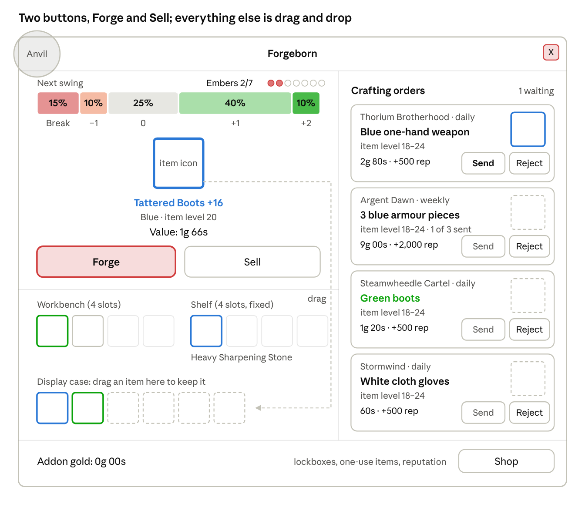
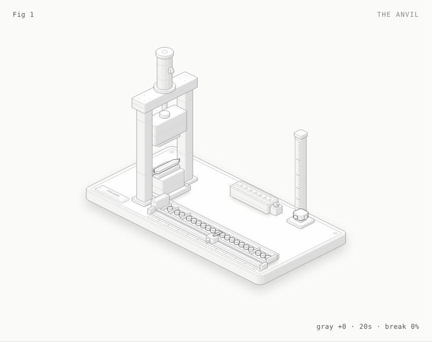

# Forgeborn

> **Branch `retail-test`:** a test build for retail WoW (12.1.5), the live client closest to WoW Forever.
> It runs the same code as `main` (the Forever release) plus test commands (`/forge test`).
> Install, differences and checklist: [docs/retail-testing.md](docs/retail-testing.md).

A push-your-luck forging minigame addon for **World of Warcraft: Forever**.

You put a copy of an item you really looted on the anvil and strike it up the
gray → white → green → blue → purple → orange ladder, one swing at a time.
Every swing can break it, so you sell before it does. Crafting orders from four
factions give you a reason to come back, and addon gold buys lockboxes in the
Shop that drop rare tools named after Classic blacksmithing items.

The window is built only from Blizzard's stock UI templates, so it looks like
part of the Forever interface. Your real items, gold and stats are never touched.



## Status

Version 1.1.0: the whole design is implemented (rules v0.4, Workbench, Shop, lockboxes,
tools, Display case, records, crafting orders, reputation, English and German). Rules v0.4
follow ForgeTax's anvil: the odds change with every level and every level multiplies the value
by 1.2. What the game's goal should be is still open: see [docs/goal-plans.md](docs/goal-plans.md).

It is tested outside the game, against Blizzard's UI source for the Forever client
(build 1.60.1.70450, see [Tests](#tests)). It has not run on a live Forever client yet:
Forever launches on 4 Nov 2026. If the client says the addon is out of date, the live
interface number differs from `16001`; tick "Load out of date AddOns" or update
`## Interface` in `Forgeborn.toc`.

### Testing before launch: branch `retail-test`

Retail WoW (Midnight, 12.1.5) is the closest live client to Forever: it shares 97% of the API functions,
93% of the UI templates, 98% of the events and 99% of the sound names Forever has; the Classic clients share
29–79% (measured with `tools/apicheck` against Blizzard's UI source for each client). The branch
[`retail-test`](../../tree/retail-test) runs the same addon code in retail, with test commands and a checklist.

## Install

Copy this repository into the `Interface/AddOns` folder of your WoW Forever installation
and name the folder `Forgeborn` (so the path ends in `Interface/AddOns/Forgeborn/Forgeborn.toc`).
The `docs`, `tests` and `tools` folders are not needed in game; the release package leaves
them out (`.pkgmeta`).

## How to play

- **Loot** a weapon or armour piece from a mob, a chest or a won loot roll. A forge copy
  lands on the **Workbench** (4 slots; when it's full, the weakest item goes).
  Rings, necklaces, trinkets, shirts, tabards, quest rewards, crafted, bought and mailed
  items don't count.
- **Click** a Workbench item to put it on the **anvil**. The bar above it shows the odds of
  the next swing: Break, −1, 0, +1, +2. The odds change with every level: each Hit raises the
  Break chance a little, a Crack lowers it again, and better items start higher.
- **Forge** strikes once. Every level multiplies the value by 1.2 (a Great hit by 1.44); the
  window shows the value now and after a Hit. Every 7 normal swings fill the embers and
  **Frenzy** fires by itself: the next 3 swings can't Miss, Crack or Break.
- **Sell** turns the item into addon gold. Or drag it into the **Display case** to keep it
  as a trophy (a small bonus to every later sale), or onto a **crafting order** card and
  click **Send**. Every item slot drags both ways: trophies come back out, staged items come
  off order cards, and sharpening stones drag onto any item.
- The **Shop** sells lockboxes (the only source of tools), sharpening stones and faction
  wares; each faction's tab shows your reputation. Tools sit on a **shelf of 4**.
- Hover anything for details; right-click items, tools and trophies for more options.
  Hover the window's portrait (top left) for your forge records.

Commands: `/forge` (open the window), `/forge shop`, `/forge records`, `/forge settings`,
`/forge reset`. The minimap addon menu opens the window (left-click) or the Shop
(right-click). Options are under Settings → AddOns → Forgeborn.

## Docs

- [docs/design.md](docs/design.md): the full design and implementation writeup
  (rules, economy, crafting orders, interface, implementation, open questions)
- [docs/goal-plans.md](docs/goal-plans.md): four plans for the game's goal (contracts, a
  collection, a guided journey, a guild ladder), with what other games do
- [docs/run-design.md](docs/run-design.md): proposal to make Forgeborn a run game with a forge
  fee every 3 crafts: the exact rules, faces, tools, consumables, inspections, meta progression
- [docs/research/](docs/research/): the relics, jokers, charms, symbols and items of ForgeTax,
  Balatro, CloverPit, Luck be a Landlord and Slay the Spire, as design reference
- [docs/wow-forever-api-notes.md](docs/wow-forever-api-notes.md): the WoW Forever UI and
  API facts the addon relies on, read from Blizzard's UI source (build 1.60.1.70450)
- [CHANGELOG.md](CHANGELOG.md)

## Tests

Lua 5.1 (the game's Lua version), [luacheck](https://github.com/lunarmodules/luacheck) and Python 3:

```sh
lua5.1 tests/run.lua                 # 114 tests: rules, game logic, the window and its layout
luacheck .                           # no undefined globals, no unused variables
python3 tools/apicheck/check_api.py  # every Blizzard API the addon uses exists in Forever
```

- `tests/test_rules.lua` checks the rules engine against the design tables and the Python
  playtest numbers, including the balance goals.
- `tests/test_game.lua` and `tests/test_ui.lua` load every file of `Forgeborn.toc` into a
  strict mock of the client (`tests/wowmock.lua`) and play it: loot, the anvil, orders,
  the Shop, drag and drop, menus, popups, combat, settings, in English and German, and once
  as the retail test build.
  Widgets only have the methods the Forever client documents; anything else fails.
- `check_api.py` checks every global, `C_` function, template, font, atlas, texture,
  sound and event against Blizzard's UI source for Forever. Its lists are built by
  `tools/apicheck/gen_fixture.py` from a clone of
  [Gethe/wow-ui-source](https://github.com/Gethe/wow-ui-source) (branch `forever`).

## Layout editor

Every position and size in the window is in [UI/Layout.lua](UI/Layout.lua). To change the
layout visually, open [tools/layout-editor/index.html](tools/layout-editor/index.html) in a
browser: the window is drawn at true pixel size; drag things to move them, drag the blue corner
to resize, check that the German text fits, then press **Copy Lua** and paste the result over
`UI/Layout.lua` (then `/reload` in game). After editing `UI/Layout.lua` by hand, run
`python3 tools/layout-editor/sync.py` so the editor starts from it (a test checks this).

## Figures

[docs/figures/anvil/anvil.html](docs/figures/anvil/anvil.html) is an interactive figure of
the rules: a drop hammer draws one of 20 tokens per strike, the tray shows the odds for the
current quality, the hearth fills toward Frenzy and the post shows the level. It runs on
[model.mjs](docs/figures/anvil/model.mjs), the same v0.3 numbers as the playtest engine.
Download the file and open it in a browser: click or Space strikes, S sells.

<picture>
  <source media="(prefers-color-scheme: dark)" srcset="docs/images/anvil-dark.gif">
  
</picture>

The GIF is one seeded run: ten strikes take a gray blade to blue +14 (a crack, three quality
steps and a 3-strike Frenzy), then it sells.

Rebuild the page with `node docs/figures/anvil/build.mjs` (Node 18+) and the GIFs with
`node docs/figures/anvil/record.mjs` (needs Playwright and ffmpeg). It is drawn with the
[Anatomy](https://github.com/wheresryan22/anatomy) isometric kit (MIT), vendored in
`docs/figures/vendor/anatomy`.

## Playtest tools

Small Python scripts used to test the rules before the Lua version existed.

```sh
cd tools/playtest
python3 forge.py new --name "Tattered Boots" --quality gray --ilvl 20 --kind armor --seed 2026
python3 forge.py swing 5
python3 forge.py sell
python3 ev_per_swing.py           # rules v0.4: expected value of one more swing per quality
python3 ev_per_swing.py --table   # rules v0.4: the odds of every grade
python3 contract_quota.py         # how often a value quota is met (docs/goal-plans.md)
python3 run_sim.py                # forge-fee runs: fee curve, income, how far players get (docs/run-design.md)
```

`forge.py` plays rules v0.3, as in the chat playtest.

## Layout

```
Forgeborn.toc    the addon (loads only in WoW Forever)
*.lua            rules engine, saved data, economy, orders, loot detection, events
Compat.lua       the few differences between Forever and retail (for the retail test build)
UI/              the window, its layout (Layout.lua), the order cards, the Shop, the settings page
tests/           test runner, strict client mock, tests
tools/apicheck/  API existence check against Blizzard's Forever UI source
tools/layout-editor/  visual editor for UI/Layout.lua
tools/playtest/  Python playtest engine and balance scripts
docs/            design writeup, API notes, figures and images
```
