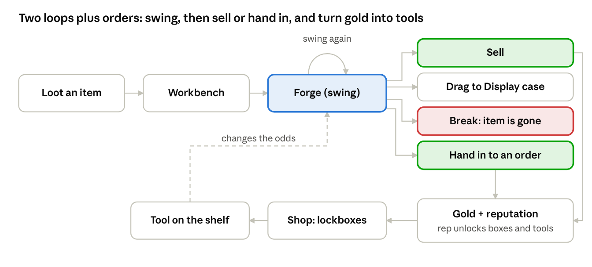
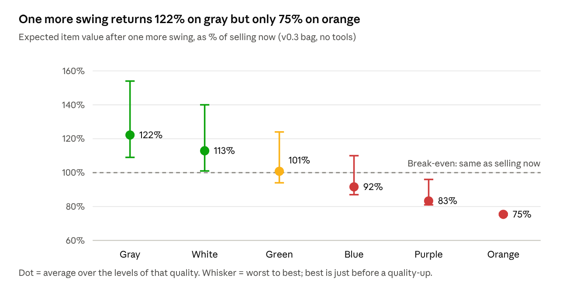
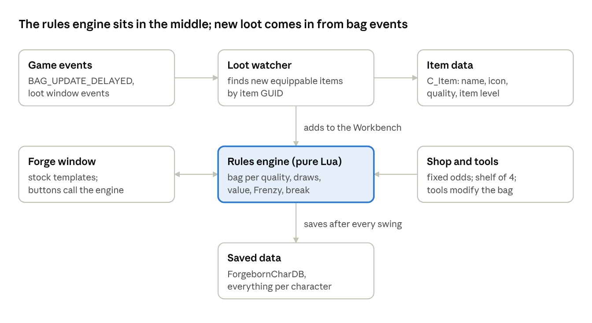

# Forgeborn — Design & Implementation Writeup

Oct 22, 2026 · @Niklas

## Summary

Forgeborn is a push-your-luck forging minigame addon for World of Warcraft: Forever. You take a copy of an item you really looted and strike it up the gray → white → green → blue → purple → orange ladder, one hit at a time. Every hit can break it, so you sell before it does.

Status: the rules are at v0.4 (23 Oct 2026): the odds change with every level and every level multiplies the value by 1.2, after a close look at ForgeTax's anvil. v0.3 came from a chat playtest on 22 Oct 2026. The addon is implemented as version 1.1.0 (23 Oct 2026) and tested outside the game against Blizzard's UI source for the Forever client (build 1.60.1.70450). It has not run on a live client yet; Forever launches on 4 Nov 2026.

The five pillars:

- **Native look.** One window built only from Blizzard's stock templates: one item slot, a big red Forge button, a Sell button. Forever's own art shows up automatically.
- **Real loot feeds it.** Only items you actually looted can be forged. Your real item, gold and stats are never touched.
- **Fixed odds, real loss.** A break destroys the item. There is no pity protection and no safety net.
- **Slow, long-term progression.** Addon gold is spent in a Shop on lockboxes, one-use items and faction wares. Lockboxes drop rare tools named after Classic blacksmithing items. The tool shelf is fixed at 4 slots.
- **A reason to come back.** One daily and one weekly crafting order from four factions pay extra gold and reputation, and each faction unlocks its own rewards.

## Research background

Forgeborn borrows its core from ForgeTax and its structure from Balatro and Luck be a Landlord. It gets its risk culture from Korean MMO item enhancement.

| Game | What it is | What Forgeborn takes |
| --- | --- | --- |
| [ForgeTax](https://store.steampowered.com/app/5245810/ForgeTax/) (GraveYardDev, Sep 2026, $2.99) | First-person roguelite: strike swords on an anvil from a 1,000-ticket deck (Success, Great, Hold, Damage, Break). Pay a dragon's rising tribute for 21 days. Frenzy = 4 s with no breaks. About 90 relics on an 8-slot shelf. | The strike-and-risk core, visible odds, auto-charged Frenzy, and a relic shelf. |
| ForgeTax reviews (Mixed, 53% of \~1,200) | Praised: the gamble feeling, cheap, nice swords. Criticised: short (1.5–4 h), odds feel rigged, too few relic slots, no meta progression, exponential late game. | Show the odds openly. Build long-term progression. Keep the shelf small anyway (a deliberate choice). |
| [CloverPit](https://en.wikipedia.org/wiki/CloverPit) (Panik Arcade, 2025) | First-person slot-machine roguelite. Pay a growing debt at an ATM or lose. 150+ charms. Over 1M copies sold. | Dark, simple, one-machine presentation. |
| Balatro (2024) | Poker roguelike: score targets per ante, jokers as passive synergies, booster packs. | Passive tools that combine, and packs (here: lockboxes) instead of a direct shop. |
| Luck be a Landlord (2021–23) | Slot-machine deckbuilder with rent due every few spins. A very plain interface. | Proof that a few buttons and a grid of icons are enough. |
| Korean MMO enhancement (Lineage, MapleStory Star Force, Black Desert) | +N upgrades where a failure can destroy the item. | The quality ladder fantasy and the "one more hit?" tension. |

The ForgeTax details come from its [Steam page](https://store.steampowered.com/app/5245810/ForgeTax/) and from Grind'n'Strat's [beginner](https://grindnstrat.com/forgetax-beginner-guide-and-walkthrough-controls-tips/), [relic](https://grindnstrat.com/forgetax-relics-and-swords-guide/) and [achievement](https://grindnstrat.com/?p=8050) guides. Balatro, Luck be a Landlord and the MMO systems are described from general knowledge.

## Design decision log

The design moved from a run-based roguelite with quotas to an open-ended push-your-luck game with a slow economy. Every change below was decided by the designer during the chat playtest.

| Topic | First idea | Decision now | Why |
| --- | --- | --- | --- |
| Screen | Grids of items like Luck be a Landlord | One item slot in the centre plus a red Forge button | Simpler, and it reads like a native bag slot |
| Pressure | A patron (dragon, Ragnaros) demanding tribute | No patron, no work orders | Nothing fancy; the item and the odds are the game |
| Goals | Hit X gold within 10 swings, then level up | Dropped. No swing limit; you swing until you sell or it breaks | Every swing becomes a real decision |
| Failure | No failing at all | A break destroys the item. Nothing is kept | The risk gives each swing its weight; frustration is part of it |
| Odds by quality | One bag for every item | The bag gets harsher with each quality, from the first swing | Better items should be riskier to push |
| Value by quality | Same formula for all | Value starts from item level × quality, so blue and purple finds are worth far more | Rare loot cost more effort in game, so it pays more |
| Frenzy | 5-second break-free window (ForgeTax) | Auto-fires every 7 normal swings and makes the next 3 swings safe | No timing skill and no saving it for later |
| Glut on quality-up | A quality-up refilled the glut | Removed | Keeps Frenzy on a steady, readable rhythm |
| Items | Looted items plus bonus offers | Only items you looted yourself | Ties the minigame to real play |
| Tools | Relics picked on level-up | Real Classic blacksmithing items, bought through lockboxes | Flavour, and slow long-term progression |
| Shelf | Expandable | Fixed at 4 slots (range 4–6 discussed, 4 chosen) | Every tool choice should hurt |
| Currency | A separate token, to avoid confusion with real gold | Shown as gold, silver and copper | Everyone understands it is a game |
| Bad luck | A pity timer | None. Fixed chances, always | Frustration is part of it |
| Seeds | Seeded, shareable runs | Not needed now | Items come from personal loot, so runs can't be identical anyway |
| Difficulty modes | Normal, Heroic, Hardcore | Dropped. Same rules for everyone, Hardcore realms included | The forge is already harsh; modes only mattered for runs with goals |

Decided after this writeup (22 Oct 2026): only real drops count as loot; only weapons and armour can be forged; everything is saved per character; and tools, not softer bags, are what make purple and orange worth forging.

Also decided: embers reset per item; items can be parked back on the Workbench at any time; the Workbench holds 4 items and drops the weakest on a new pickup; orange has no level cap.

Round three: duplicate tools grow one rarity step; displayed trophies give a small passive bonus; no difficulty modes; personal forge records as the long-term goal.

Round four added crafting orders as the reason to keep playing: 1 daily and 1 weekly order from a random one of four factions, asking for a slot and a minimum quality near your level, paid in gold and WoW-style reputation, held on a 3-slot board next to the anvil, never expiring but rejectable for a small reputation loss.

Then: the weekly gets its own slot and asks for several items at the daily quality; the capital city unlocks a 4th daily slot at Honored; the window gives no match hints.

Later the same day: the window shows the next swing as a coloured odds bar; lockboxes are sold in a Shop together with one-use items and faction wares; each order's faction is random instead of rotating.

Then: only two action buttons remain, Forge and Sell. Moving an item to the Display case, the Workbench or an order is drag and drop.

Then: reputation moved into the Shop, one tab per faction, so the footer has only the Shop button.

23 Oct 2026, while testing in retail: the odds change with every hit, as in ForgeTax, and the price changes with every swing by a multiplier (×1.2 per level). This is rules v0.4. Every item slot is a drag source and a drop target. The window's layout moved into a data file with a visual editor. What the game's goal should be is open; the options are in [goal-plans.md](goal-plans.md).

## Rules v0.4

Decided on 23 Oct 2026 after a close look at ForgeTax's anvil ([odds](https://www.forgetax.tools/guides/forging-odds), [sword value](https://www.forgetax.tools/guides/sword-value)): the odds change with every level, and the value grows by a multiplier per level. Everything else in v0.3 stays: the quality ladder, cracks that never cost a quality, embers and Frenzy, safe swings, tools.

How ForgeTax does it: every strike draws one ticket out of 1,000. The deck holds 2 Damage, 5 Hold, 12 Success and 2 Great tickets; the Break pile gets a weight from the sword's grade, chosen so that Break comes out at a curve's value (0% at +0, 24.8% at +4, 46.7% at +10, 72% from +30). The other four share the rest in their fixed ratio, so a relic that adds tickets also lowers Break. A sword is worth 320 G × 1.5 per level.

Forgeborn v0.4 does the same with its own numbers:

- **Grade.** The odds depend on the grade: the level counted from the start of gray, so better drops start higher. Gray starts at grade 0, white 4, green 8, blue 13, purple 19, orange 26. A blue drop at +0 is grade 13.
- **The deck.** Crack 2, Miss 4, Hit 12, Great hit 2 tokens (`Data.DECK`). The Break pile weighs 20 × p / (1 − p), where p is the curve's chance, so on the plain deck Break comes out at exactly p. Tools add or remove tokens as before; a tool that adds tokens also lowers the Break chance. The deck is scaled to 1,000 whole tickets (largest remainder), so the odds shown are the odds drawn.
- **Break curve** (`Data.BREAK_CURVE`), rising evenly between these points:

| Grade | 0 | 2 | 4 (white) | 8 (green) | 13 (blue) | 19 (purple) | 26 (orange) | 36 | 50 and up |
| --- | --- | --- | --- | --- | --- | --- | --- | --- | --- |
| Break | 0% | 2% | 6% | 12% | 20% | 30% | 40% | 55% | 70% |

- **Value.** Item level × the start quality's factor × 1.2 per level (`Data.VALUE_PER_LEVEL`): a Hit is ×1.2, a Great hit ×1.44, a Crack ÷1.2.

```latex
\text{value (silver)} = \text{item level} \times \text{factor of the start quality} \times 1.2^{\text{level}}
```

  Example: gray boots of item level 20 forged to blue +13 are worth 20 × 1.2¹³ = 214 silver (2g 14s); a blue drop of item level 20 is worth 64 silver at +0 and 1g 59s at +5.
- **Righteous Orb.** Orange items are worth +40% (+85% at legendary), instead of orange counting ×9 (×12).

Odds at the start of each quality (all grades: `python3 tools/playtest/ev_per_swing.py --table`):

| Grade | Break | Crack −1 | Miss 0 | Hit +1 | Great hit +2 | Value |
| --- | --- | --- | --- | --- | --- | --- |
| 0, gray | 0% | 10% | 20% | 60% | 10% | ×1 |
| 4, white | 6% | 9.4% | 18.8% | 56.4% | 9.4% | ×2.1 |
| 8, green | 12% | 8.8% | 17.6% | 52.8% | 8.8% | ×4.3 |
| 13, blue | 20% | 8% | 16% | 48% | 8% | ×10.7 |
| 19, purple | 30% | 7% | 14% | 42% | 7% | ×31.9 |
| 26, orange | 40% | 6% | 12% | 36% | 6% | ×114.5 |

One more swing, as a share of selling now (item started gray, no tools, Frenzy not counted): gray 113%, white 106%, green 98%, blue 87%, purple 76%, orange 64% (v0.3: 122, 113, 101, 92, 83, 75). So the story of v0.3 holds: gray and white pay, green is break-even, blue and up lose.

Best stop-or-swing strategy (Frenzy and the Sulfuron Ingot included, 30 swings), as a ratio to selling at once:

| Tools | Gray | White | Green | Blue | Purple | Orange |
| --- | --- | --- | --- | --- | --- | --- |
| None | 5.39 | 2.54 | 1.50 | 1.00 | 1.00 | 1.00 |
| Epic Hammer, Fiery Core, Lava Core, Arcanite Bar | 53.1 | 25.5 | 11.5 | 4.89 | 2.08 | 1.00 |
| Legendary Sulfuron Ingot, Fiery Core, Lava Core, Arcanite Bar | 562 | 275 | 129 | 47.5 | 18.1 | 6.85 |

The design goals still hold: without tools, selling at once is best from blue up; epic tools make purple worth forging but not orange; legendary tools with the Sulfuron Ingot make orange worth forging. **To tune:** with a value that multiplies, strong tools snowball far more than in v0.3 (where the same legendary set gave 5.31 at blue). Lockbox prices, the tools' token counts or `VALUE_PER_LEVEL` need a look once tools are in play.

## Rules v0.3

v0.3 was the rule set of the chat playtest and of version 1.0.0. v0.4 above replaces its strike bags and its value formula.

Each swing draws one token from a 20-token bag set by the item's current quality. From blue upward, at least 3 tokens in 20 break the item.

**Terms** (German names from the playtest in brackets): Hit (Treffer), Great hit (Volltreffer), Miss (Fehlschlag), Crack (Riss), Break (Bruch), Embers (Glut), Frenzy (Raserei), Workbench (Werkbank), Shelf (Regal), Display case (Vitrine), Lockbox (Kassette).



*game loop · rules v0.3*

The inner loop is one item and one decision per swing. The outer loop turns sold items into tools that change the odds for every later item. Crafting orders add a fourth choice after any swing: hand the item in for extra gold and reputation.

### The anvil

1. Loot an item in game. It appears on the Workbench.
2. Click it to put a forge copy on the anvil. The real item is never changed.
3. Press **Forge**. One token is drawn, with replacement.
4. After any swing you may **Sell** (value → addon gold) or drag the item into the **Display case** (kept as a trophy, no gold).
5. A Break destroys the copy. Nothing is refunded.

### Workbench

- Holds 4 items: new drops and parked half-forged items.
- When a new drop arrives and all 4 slots are taken, the lowest quality item goes. Lowest item level breaks ties. The new drop itself can be the one that goes.
- The item on the anvil can be parked back on the Workbench at any time and keeps its level.

### Strike bag by quality (tokens out of 20)

| Quality | Hit +1 | Great hit +2 | Miss 0 | Crack −1 | Break | Break chance per swing | Levels to next quality | Value factor |
| --- | --- | --- | --- | --- | --- | --- | --- | --- |
| Gray | 14 | 3 | 2 | 1 | 0 | 0% | 4 | 1 |
| White | 13 | 3 | 2 | 1 | 1 | 5% | 4 | 1.5 |
| Green | 11 | 2 | 4 | 1 | 2 | 10% | 5 | 2.2 |
| Blue | 8 | 2 | 5 | 2 | 3 | 15% | 6 | 3.2 |
| Purple | 6 | 1 | 6 | 3 | 4 | 20% | 7 | 4.6 |
| Orange | 4 | 1 | 7 | 3 | 5 | 25% | last quality; +N keeps rising | 6.5 |

A Crack never drops the level below the start of the current quality, so an item can't lose a quality.

### Value

```latex
\text{value (silver)} = \text{item level} \times \text{quality factor} \times (1 + 0.1 \times \text{level})
```

Example: blue boots of item level 20 at +16 are worth 20 × 3.2 × 2.6 = 166 silver (1g 66s).

### Embers and Frenzy

- Every normal swing adds 1 ember.
- At 7 embers, Frenzy fires automatically. The next 3 swings can't Miss, Crack or Break; such tokens are redrawn.
- Swings during Frenzy add no embers. A quality-up adds no embers. Embers reset to 0 whenever an item is put on the anvil.

### Tools on the shelf

Tools are passive and change the bag or the value, for example Fiery Core (Feuerkern): Great hits give +3 instead of +2. The shelf holds 4 tools, permanently. Tools come only from lockboxes (see Economy).

## Economy

Sold items give addon gold. Gold buys lockboxes, and lockboxes drop tools at fixed odds with no pity protection. All prices and odds below are first drafts.

- **Addon gold** is shown as gold, silver and copper. It belongs to one character, is not that character's real gold, and can't be traded.
- **The Shop.** Addon gold is spent in a Shop. It sells lockboxes in several tiers (named after Classic rogue lockboxes), one-use items, and faction wares that reputation unlocks. Ordinary tools are never sold directly; they come from lockboxes. Reputation lives in the Shop too: each faction has its own tab with its reputation bar and the wares its ranks unlock.
- **Shelf of 4.** A new tool replaces an old one when the shelf is full. The shelf never grows.

### Lockboxes

| Lockbox | Price | Contents |
| --- | --- | --- |
| Bronze | 5g | Mostly one-use items; 10% chance of a rare tool |
| Iron | 20g | 30% rare tool, 3% epic tool |
| Thorium | 100g | One rare tool guaranteed; 15% epic, 1% legendary |

At the playtest's value level (1–3 gold per sold item at character level 20), a Bronze box costs 2–5 good sales. Prices need tuning against level-60 values.

### Tool catalogue

Tools have their own quality colour. Names are real Classic blacksmithing items; the German names are the official client names. The values every rarity step gives are in [First tuning values](#first-tuning-values-v100).

| Tool | Rarity | Effect |
| --- | --- | --- |
| Blacksmith Hammer (Schmiedehammer) | Common | +2 Hit tokens |
| Weak Flux (Schwacher Fluxus) | Common | −1 Crack token |
| Heavy Sharpening Stone (Schwerer Wetzstein) | Common | Weapons are worth +25% |
| Strong Flux (Starker Fluxus) | Rare | −2 Crack tokens |
| Thorium Bar (Thoriumbarren) | Rare | Armour is worth +20% |
| Fiery Core (Feuerkern) | Rare | Great hits give +3 instead of +2 |
| Lava Core (Lavakern) | Rare | +2 Great-hit tokens |
| Dark Iron Bar (Dunkeleisenbarren) | Rare | After a Miss, the next Hit gives +2 |
| Arcanite Bar (Arkanitbarren) | Epic | −2 Break tokens (−3 at legendary) |
| Blood of the Mountain (Blut des Berges) | Epic | Frenzy lasts 5 swings instead of 3 |
| Elemental Flux (Elementarfluxus) | Epic | Frenzy fires every 5 swings instead of 7 |
| Righteous Orb (Rechtschaffene Kugel) | Epic | Orange counts ×9 instead of ×6.5 |
| Sulfuron Ingot (Sulfuronblock) | Legendary | The first Break of each item becomes a Crack |

### One-use items

- Coarse Sharpening Stone: the next swing is safe.
- Dense Sharpening Stone: the next 3 swings are safe.
- A small purse of addon gold.

### Duplicates, Display case and records

- **Duplicate tool:** the owned tool rises one rarity step and its effect grows, e.g. a rare Fiery Core becomes epic. The exact values per step are still to be tuned.
- **Display case:** putting an item there instead of selling it gives a small passive bonus, e.g. +1% value per displayed orange item. The bonus size and the number of slots are still to be tuned.
- **Forge records:** highest +N reached per quality, most valuable sale, longest run of swings without a break, number of gray items taken to orange.

### Pacing target (proposal)

The designer wants tools to be hard to get, because WoW is played for months. A proposed target: the first rare tool after 2–3 hours of play, the first epic after about 2 weeks, a legendary as a months-long goal. Item supply is capped by real loot, which slows everything down naturally.

## Crafting orders

Crafting orders give every session a goal: one daily and one weekly order arrive from four factions, picked at random, and finishing one pays more gold than selling plus reputation. Decided on 22 Oct 2026; numbers marked as proposals still need tuning.

### How orders work

- **Arrival:** 1 daily order per day and 1 weekly order per week, at WoW's daily and weekly reset. The giving faction is picked at random from the four.
- **The ask:** a slot and a minimum quality, e.g. "Blue boots". The item level must be near the character's level (proposal: within 5 levels), so orders grow with you. The weekly asks for several items at that same quality, e.g. 3 blue armour pieces, handed in one at a time during the week. There are no match hints: you judge yourself which item fits.
- **Board:** 3 daily slots plus 1 weekly slot, shown next to the anvil; the capital city adds a 4th daily slot at Honored. When all daily slots are taken, today's new order waits in a queue. A queued daily that is still waiting at the next daily reset is dropped.
- **No expiry:** an order stays until you finish or reject it.
- **Hand-in:** drag a forged copy from the anvil or the Workbench onto the order's item slot, then click **Send**. The copy is used up instead of sold.
- **Fulfilment:** at least the asked quality counts. Each quality step above the ask pays a bonus (proposal: +50% gold and reputation per step).
- **Rewards (proposal):** daily = 2× the item's sale value and 500 reputation; weekly = 4× each item's sale value and 2,000 reputation once the last item is in.
- **Rejecting:** allowed at any time; costs about a quarter of the reputation finishing would have given.

### Factions and reputation

Ranks work like WoW reputation: Neutral, Friendly, Honored, Revered, Exalted, with the same kind of bar as the reputation window, shown on each faction's tab in the Shop. Each faction asks for its own kind of gear and unlocks a different kind of reward.

| Faction | Asks for | Unlocks (proposal) |
| --- | --- | --- |
| Thorium Brotherhood | Weapons and plate armour | Exclusive tools, one per rank from Honored; Sulfuron Ingot at Exalted |
| Steamwheedle Cartel | Any slot, high-value items | Iron lockbox at Honored, Thorium lockbox at Revered, cheaper lockboxes at Exalted |
| Capital city quartermaster (Stormwind, Ironforge, Orgrimmar or Undercity) | Everyday cloth, leather and mail | A 4th order slot at Honored and one-use items in its shop |
| Argent Dawn | Armour | More Display case slots and stronger trophy bonuses |

Pace check with the proposed numbers: each faction gets about 1,375 reputation a week on average, so Exalted (42,000 from Neutral) takes about 30 weeks. That matches the months-long goal.

## Playtest log and balance findings

Under v0.3, one more swing gains value only on gray and white items; from blue up, selling at once is the better bet. All playtest swings were real random draws from a seeded engine on 22 Oct 2026.

| Rules | Item | What happened | Lesson |
| --- | --- | --- | --- |
| v0.3 (no limit, break) | Tattered boots, blue +15, 1g 60s | Miss, Hit (+16, 1g 66s), then a Break on swing 3. The designer pushed every time and lost it all. | At 15% per swing, surviving 3 swings is only 61%. The loss stings, as intended. |
| v0.2 (goal from item level) | Tattered boots, gray, item level 20 | Gray → blue +15 in 10 swings. Frenzy on swings 8–10 brought two Great hits. Goal 1g 20s, reached 1g 60s. | Gray items climb fast because their bag is kind. |
| v0.2 (simulation) | Same boots, carried into goal 2 | Goal 2 was reached before the first swing. | Goals tied to item level break when an item carries over. Goals were later dropped. |
| v0.1 (fixed gold goals) | Chain shirt of the bear, green | Green → blue +8, 1g 58s. Missed the 2g goal by 42s. | With fixed gold goals, blue items succeeded 90% of the time and gray 2%. That led to quality-based odds. |



*computed from the v0.3 strike bag · item started gray · no tools, Frenzy not counted*

What this means for play:

- Gray and white items are free money: forge them until they turn green.
- Green is break-even. It pays only on the swing just before a quality-up.
- Blue loses about 8% per swing. Purple loses 17% and orange 25%, so pushing them is pure gambling.
- Frenzy swings can't break, so each Frenzy is always worth taking. Tools that cut Break tokens are the only way to make purple and orange worth forging.

Decided: the base curve stays. A strong tool set should be able to bring purple and orange to break-even.

## Interface

The whole game is one small native window: the anvil with only two buttons, Forge and Sell, on the left, and the crafting orders on the right. Everything else is drag and drop. Every part maps to a stock Blizzard template, so Forever's own art is used automatically.


*mock-up · not to scale · values from the playtest*

The odds bar above the item shows every outcome of the next swing (Break, −1, 0, +1, +2) as coloured sections with their percentages, here for a blue item. It changes with the item's quality, with tools, and during Frenzy, when only +1 and +2 remain. The item slot looks like a bag slot with its quality border.

| Element | Native building block | Notes |
| --- | --- | --- |
| Window | `PortraitFrameTemplate`, registered in `UIPanelWindows` with area left | Opens beside the Character frame and closes with Esc, like Forever's own Legacy window; in combat it shows and hides itself |
| Odds bar | 5 textures in one row, widths set from the current bag; percentages in `GameFontHighlightSmall` | Break red, −1 orange, 0 grey, +1 light green, +2 green |
| Anvil slot | `CreateFrame("ItemButton")`, scaled up, + `SetItemButtonQuality`; empty slots use the bags' `bags-item-slot64` art | Real icon, quality border; drag source and target. (`LargeItemButtonTemplate` and `SmallItemButtonTemplate` are quest-reward rows with a name plate, not bag slots.) |
| Item name and value | `GameFontNormalLarge` in the quality colour; `GetMoneyString` | Value in gold, silver and copper |
| Forge button | `SharedButtonLargeTemplate` (the red three-slice button Forever's character frame uses) | The only big button |
| Sell button | `UIPanelButtonTemplate` | The only other action button |
| Embers | Up to 7 small round textures (circle mask) | Fill toward the automatic Frenzy; fewer with Elemental Flux |
| Workbench and Shelf | `ItemButton` rows inside an `InsetFrameTemplate` | Drag between Workbench and anvil; tooltips via `GameTooltip` |
| Display case | A row of `ItemButton` drop slots | Drag the anvil item here to keep it as a trophy |
| Shop button | `UIPanelButtonTemplate` in the footer | Opens the Shop; the only footer button |
| Shop | A second panel from `ButtonFrameTemplate` with tabs (PanelTabButtonTemplate): a General tab plus one tab per faction | General: lockboxes and one-use items. Each faction tab: its reputation bar (ColoredProgressBarTemplate) and the wares its ranks unlock |
| Lockbox opening | `StaticPopupDialogs` to confirm, then a reveal in the slot | Rare drops use the quality colour |

The orders panel shows 4 order cards, 3 daily and 1 weekly (5 with the capital city's 4th slot), each with faction, ask, item-level range, reward, an item drop slot, Send and Reject, plus the number of queued orders. Forged copies are not real items, so drag and drop runs on our own item buttons (`RegisterForDrag`, `OnDragStart`, `OnDragStop` and a check for the drop target under the mouse) rather than the game cursor.

Entry points and behaviour:

- Minimap addon menu (the addon compartment exists in Forever), `/forge`, and a page in the standard Settings panel.
- Sounds from `SOUNDKIT`, e.g. the reforge sound on a strike, the artifact-forge rank-up sound on a quality-up and the legendary loot toast on orange. All sounds still need checking in game.
- A glow in the quality colour on a quality-up (the item buttons' own highlight art, tinted and pulsed; `AnimatedShineTemplate` lives in a separate Blizzard addon). A short red flash and the slot emptying on a Break.
- German and English text from day one. The window stays usable in combat; nothing is locked.

## WoW Forever: technical facts

Forever runs on the modern retail engine and UI framework under the internal codename Camelot, with its own art behind retail's template names. So a retail-style addon built from stock templates looks native in Forever. The facts below come from Blizzard's UI source for build 1.60.1.70450 (16 Oct 2026), mirrored in [Gethe/wow-ui-source](https://github.com/Gethe/wow-ui-source), branch `forever`.

| Fact | Value | Where it comes from |
| --- | --- | --- |
| Launch | 4 Nov 2026; level cap 60; 2004 world plus new zones, raids and Hardcore realms | [Blizzard](https://worldofwarcraft.blizzard.com/en-us/forever), [Warcraft Wiki](https://warcraft.wiki.gg/wiki/World_of_Warcraft:_Forever) |
| Game type | `camelot`; `WOW_PROJECT_ID = WOW_PROJECT_CAMELOT = 18` | `Blizzard_ProjectConstants/Camelot/ProjectConstants.lua` |
| Family | `mainline` (retail), not `classic` | TOC load rules: `[Family]` = Mainline, `[Game]` = Camelot |
| Interface number | 16001 on beta/test; check live with `select(4, GetBuildInfo())` | [TOC format](https://warcraft.wiki.gg/wiki/TOC_format) |
| TOC file names | `MyAddon_Forever.toc` or `_Camelot.toc`; `_Mainline.toc` also matches | [TOC format](https://warcraft.wiki.gg/wiki/TOC_format) |
| Native art | Camelot ships its own art under retail atlas names; only offsets are patched | `Blizzard_SharedXML/Camelot/NineSliceLayoutOverrides.lua` |
| Forever-only UI | Character frame, paper doll, skills, reputation, bags, bank, stable, friends, unit frames, minimap, addon compartment, Legacy system | About 200 `[Game]` lines across Blizzard's TOCs |
| Addon restrictions | Retail's "secret values" are present (3,680 functions allowed only when untainted, 92 not allowed) | `Blizzard_APIDocumentationGenerated` |
| API docs | 643 generated documentation files for this exact client | Same folder; `/api` in game |

The secret-value rules protect combat data. A self-contained minigame does not touch it, so they should not matter here.

## Implementation (v1.0.0)

The addon is about a dozen Lua files around a pure-Lua rules engine. The window is built in Lua from Blizzard's stock templates (no XML). Every file runs outside the game in the tests, against a strict mock of the client.



*architecture · the files below implement it*

Loot enters from bag events, the engine owns all rules, and everything is kept in the saved data after each action, so a disconnect never loses a forge.

### TOC

```toc
## Interface: 16001
## Title: Forgeborn
## AllowLoadGameType: camelot
## SavedVariablesPerCharacter: ForgebornCharDB
## IconTexture: Interface\Icons\Trade_BlackSmithing
## AddonCompartmentFunc: Forgeborn_OnCompartmentClick
## AddonCompartmentFuncOnEnter: Forgeborn_OnCompartmentEnter
## AddonCompartmentFuncOnLeave: Forgeborn_OnCompartmentLeave
Locales.lua
Data.lua
Compat.lua
Rules.lua
Util.lua
Database.lua
Economy.lua
Forge.lua
Orders.lua
Loot.lua
UI\Widgets.lua
UI\Main.lua
UI\Orders.lua
UI\Shop.lua
UI\Options.lua
Core.lua
```

### Files

| File | Job |
| --- | --- |
| `Data.lua` | Every number: bags, value factors, tools and their rarity steps, lockboxes, factions and wares, order settings. No WoW API calls. |
| `Compat.lua` | The few differences between Forever and retail WoW, so the retail test build (branch `retail-test`) runs the same code. |
| `Rules.lua` | Bags with tools, draws, safe swings, Frenzy, cracks, breaks, value. No WoW API calls, so it runs in plain Lua. |
| `Locales.lua` | English and German text. Item names come from the client when it has them, in any language. |
| `Database.lua` | Saved data per character, defaults, and repair of damaged data. |
| `Economy.lua` | Addon gold, reputation, the Shop, lockboxes, the shelf, one-use items, the Display case. |
| `Forge.lua` | The anvil and the Workbench: strike, sell, park, display, records. |
| `Orders.lua` | Daily and weekly arrivals at WoW's resets, the board and queue, hand-in checks, rewards, rejects. |
| `Loot.lua` | Finds new drops and puts a forge copy on the Workbench. |
| `UI/*.lua` | The window, the order cards, the Shop, the Settings page, drag and drop, tooltips, menus, effects. |
| `Core.lua` | Events, `/forge`, the minimap addon menu. |

### What the window does

- **Opening:** `ShowUIPanel` places the window like a native panel (left side, Esc closes it). Blizzard blocks `ShowUIPanel` and `HideUIPanel` for addons in combat, so in combat the window and the Shop show and hide themselves directly; nothing is locked in combat.
- **Drag and drop** runs on the addon's own buttons: the source button starts a drag and on release the drop target under the mouse takes it. Every drag also has a click or right-click menu: click a Workbench item to put it on the anvil, right-click items, tools and trophies for their options, click a sharpening stone to use it.
- **No match hints:** order cards never highlight a fitting item; Send checks the item and says what doesn't fit.
- **Every item slot drags both ways** (1.1.0): the anvil and the Workbench take any item, trophies and sharpening stones; trophies drag back out of the Display case (they keep the whole item) or swap with an item dropped on them; a staged item drags off an order card; an item dropped on a sharpening stone uses it; a shelf tool dropped on the waiting new tool swaps with it.
- **Layout** (1.1.0): every position and size in the window is in `UI/Layout.lua`. `tools/layout-editor/index.html` shows the window at true pixel size, lets you drag and resize everything, and writes the file back.
- **Records** show in the tooltip of the window's portrait and with `/forge records`.
- **Settings page** (Settings → AddOns → Forgeborn): sounds on or off, and chat lines for new Workbench items.

### Loot detection

1. A loot window's weapons and armour become expected drops, by item ID, for 5 minutes (10 for a won roll, `LOOT_ITEM_ROLL_WON`). A loot window from a container item in the bags (`LOOT_OPENED` with `isFromItem`) doesn't count.
2. On `BAG_UPDATE_DELAYED` the bags are scanned for item GUIDs that weren't there before. A new item that matches an expected drop goes to the Workbench. Items already in the bags at login or reload never count.
3. Nothing counts while a merchant, mailbox, trade, auction house or bank window is open; quest rewards (`QUEST_LOOT_RECEIVED`) cancel a matching expectation.

Known gap: items handed out by a master looter arrive without a loot window or roll, so they don't count.

### Saved data

`ForgebornCharDB` (per character): `gold` (copper), `shelf` (4 slots of tool id and rank), `pendingTool`, `consumables`, `display` (trophies), `workbench` (4 slots), `anvil`, `orders` (daily list, weekly, queue, the last reset times), `rep` per faction, `records`, `stats`, `settings`. A forge copy keeps its item ID, name, link, icon, start quality, item level, kind, slot, armour type, level, embers, Frenzy and safe swings, and whether the Sulfuron Ingot has saved it.

### First tuning values (v1.0.0)

Every value below was chosen when the addon was built, to match the proposals above. They are first values to check in play.

**Tool rarity steps.** A duplicate raises the owned tool one step (Common → Rare → Epic → Legendary). A duplicate of a legendary tool is salvaged for 1g, 5g, 25g or 100g, by the duplicate's own rarity.

| Tool | Common | Rare | Epic | Legendary |
| --- | --- | --- | --- | --- |
| Blacksmith Hammer | +2 Hit | +3 | +4 | +5 |
| Weak Flux | −1 Crack | −2 | −3 | −4 |
| Heavy Sharpening Stone | weapons +25% | +35% | +50% | +75% |
| Strong Flux | | −2 Crack | −3 | −4 |
| Thorium Bar | | armour +20% | +30% | +45% |
| Fiery Core | | Great hit +3 | +4 | +5 |
| Lava Core | | +2 Great hit | +3 | +4 |
| Dark Iron Bar | | Hit after a Miss +2 | +3 | +4 |
| Enchanted Thorium Bar (Thorium Brotherhood) | | +1 Hit, −1 Miss | +2/−2 | +3/−3 |
| Arcanite Bar | | | −2 Break | −3 |
| Blood of the Mountain | | | Frenzy 5 swings | 7 |
| Elemental Flux | | | Frenzy every 5 | every 4 |
| Righteous Orb | | | orange ×9 | ×12 |
| Elemental Sharpening Stone (Thorium Brotherhood) | | | purple and orange +20% | +35% |
| Sulfuron Ingot | | | | first Break → Crack |

Token tools stack and never take a token count below 0. A new tool with a full shelf waits in a slot under the shelf; drag it onto a shelf slot to replace a tool, or discard it. Lockboxes and tools can't be bought while one waits.

**Lockboxes** (named after Classic rogue lockboxes):

| Lockbox | Price | Unlock | Contents |
| --- | --- | --- | --- |
| Ornate Bronze Lockbox | 5g | always | 10% rare tool, 25% common tool, 40% Coarse Sharpening Stone, 10% Dense Sharpening Stone, 15% purse of 1–4g |
| Iron Lockbox | 20g | Steamwheedle Honored | 3% epic tool, 30% rare, 40% common, 12% Dense Sharpening Stone, 15% purse of 5–15g |
| Thorium Lockbox | 100g | Steamwheedle Revered | 1% legendary tool, 15% epic, 84% rare |

**One-use items.** Coarse Sharpening Stone (2g): the next swing is safe. Dense Sharpening Stone (5g, capital city Friendly): the next 3 swings are safe. Safe swings work like Frenzy swings: Miss, Crack and Break are redrawn and no ember is added. They come after any Frenzy swings and stay with the item when it is parked.

**Faction wares:**

| Faction | Friendly | Honored | Revered | Exalted |
| --- | --- | --- | --- | --- |
| Thorium Brotherhood | | Enchanted Thorium Bar, 40g | Elemental Sharpening Stone, 150g | Sulfuron Ingot, 600g |
| Steamwheedle Cartel | | Iron Lockbox | Thorium Lockbox | lockboxes 20% cheaper |
| Capital city | Dense Sharpening Stone | 4th daily order slot | one-use items 25% cheaper | one-use items 50% cheaper |
| Argent Dawn | +1 Display case slot | +1 slot | trophy bonuses ×1.5 | +1 slot, trophy bonuses ×2 |

The capital city is Stormwind (humans, night elves), Ironforge (dwarves, gnomes), Orgrimmar (orcs, trolls, tauren) or Undercity (undead).

**Display case.** 3 slots, up to 6 with the Argent Dawn. Each trophy adds to every sale: green +0.25%, blue +0.5%, purple +0.75%, orange +1%.

**Crafting orders.**

- Item level: within 5 of the character's level when the order arrives; no upper limit at level 60.
- Minimum quality (white, green, blue, purple): 15/45/30/10% by default, 0/30/50/20% for the Steamwheedle Cartel, 30/50/20/0% for the capital city. Weekly orders ask for 3 items at 20/50/30/0%.
- Thorium Brotherhood: a weapon group (one-hand, two-hand, ranged) or, from level 40, a plate armour slot. Weekly: weapons or plate armour.
- Steamwheedle Cartel: any armour slot or weapon group. Weekly: anything.
- Capital city: a cloth, leather or mail armour slot. Weekly: armour of that type.
- Argent Dawn: any armour slot. Weekly: armour.
- Rewards and rejects as proposed: daily 2× sale value and 500 reputation, weekly 4× each item's value and 2,000 reputation when the last item is in, +50% per quality step above the ask, a reject costs 125 (daily) or 500 (weekly) reputation. Reputation never drops below Neutral.

### Balance check (rules v0.3)

The v0.4 numbers are in [Rules v0.4](#rules-v04). The tests compute the best stop-or-swing strategy (Frenzy and the Sulfuron Ingot included) as a ratio to selling at once. 1.00 means selling at once is best.

| Tools | Blue | Purple | Orange |
| --- | --- | --- | --- |
| None | 1.00 | 1.00 | 1.00 |
| Epic Hammer, Fiery Core, Lava Core, Arcanite Bar | 2.14 | 1.14 | 1.00 |
| Legendary Sulfuron Ingot, Fiery Core, Lava Core, Arcanite Bar | 5.31 | 2.84 | 1.62 |

Without tools, selling at once stays the best play from blue up, as the playtest found. Epic tools make purple worth forging; orange needs the legendary Sulfuron Ingot. No tool set removes every Break token from purple or orange. The Arcanite Bar was raised from −1 to −2 Break tokens (−3 at legendary) to reach this; at −4 purple would have become risk-free.

### Tests

- `lua5.1 tests/run.lua`: 114 tests. The rules engine against the tables above and the Python playtest numbers; the game logic, the window and its layout inside a strict mock of the client, in English and German, as Forever and as the retail test build.
- `luacheck .`: no undefined globals and no unused variables.
- `python3 tools/apicheck/check_api.py`: every global, `C_` function, template, font, atlas, texture, sound and event the addon uses exists in Blizzard's UI source for Forever.

## API reference

Every template and function below exists in the Forever UI source. None has been run on a live Forever client yet.

### Window and controls

| Need | Template or API |
| --- | --- |
| Standard window | `PortraitFrameTemplate` (`SetTitle`, `SetPortraitToAsset`); also `ButtonFrameTemplate`, `DefaultPanelTemplate` |
| Open like a native panel | `UIPanelWindows[name] = { area = "left", pushable = 1 }`, `ShowUIPanel`, `HideUIPanel`; or `tinsert(UISpecialFrames, name)` for Esc only |
| Inner panel, borders | `InsetFrameTemplate`, `ThinGoldEdgeTemplate`, `DialogBorderTemplate` |
| Buttons | `BigRedThreeSliceButtonTemplate`, `SharedGoldRedButtonTemplate`, `UIPanelButtonTemplate`, `SharedButtonTemplate` |
| Item slots | `CreateFrame("ItemButton")`, `SmallItemButtonTemplate`, `LargeItemButtonTemplate`, `GiantItemButtonTemplate`; `SetItemButtonTexture`, `SetItemButtonQuality`, `SetItemButtonDesaturated` |
| Progress bar | `ColoredProgressBarTemplate` (Forever has its own version) |
| Money | `SmallMoneyFrameTemplate`, `GetMoneyString(copper)` |
| Tabs, checkbox, slider, input | `PanelTabButtonTemplate`, `LargeSideTabButtonTemplate`, `UICheckButtonTemplate`, `MinimalSliderWithSteppersTemplate`, `InputBoxTemplate` |
| Menus | `MenuUtil.CreateContextMenu`, `MenuUtil.CreateButtonMenu`, `WowStyle1DropdownTemplate` |
| Confirm dialog | `StaticPopupDialogs`, `StaticPopup_Show` |
| Tooltip | `GameTooltip:SetOwner`, `AddLine`, `AddDoubleLine` |
| Effects | `AnimatedShineTemplate`, `AnimationGroup` |
| Fonts | `GameFontNormal` (gold), `GameFontHighlight` (white), `GameFontNormalLarge`, `NumberFontNormal` |

### Game data and system

| Need | API |
| --- | --- |
| Item info | `C_Item.GetItemInfo`, `GetItemInfoInstant`, `GetItemQualityByID`, `GetItemIconByID`, `GetDetailedItemLevelInfo`, `IsEquippableItem`, `DoesItemExistByID` |
| Async item loading | `Item:CreateFromItemID(id):ContinueOnItemLoad(fn)`; events `ITEM_DATA_LOAD_RESULT`, `GET_ITEM_INFO_RECEIVED` |
| Quality colours | `Enum.ItemQuality` (Poor 0 to Legendary 5), `C_Item.GetItemQualityColor`, `ITEM_QUALITY_COLORS` |
| Bags | `C_Container.GetContainerNumSlots`, `GetContainerItemInfo`, `GetContainerItemID`; `C_Item.GetItemGUID(ItemLocation:CreateFromBagAndSlot(bag, slot))` |
| Loot window | `LOOT_READY`, `LOOT_OPENED`, `GetNumLootItems`, `GetLootSlotLink` |
| Timers | `C_Timer.After`, `C_Timer.NewTicker` |
| Sound | `PlaySound(SOUNDKIT.UI_70_ARTIFACT_FORGE_TRAIT_RANKUP)`, `UI_LEGENDARY_LOOT_TOAST`, `UI_EPICLOOT_TOAST`, `UI_BONUS_LOOT_ROLL_START`, `LOOT_WINDOW_COIN_SOUND` |
| Settings page | `Settings.RegisterVerticalLayoutCategory`, `Settings.RegisterAddOnCategory`, `Settings.RegisterCanvasLayoutCategory` |
| Minimap entry | TOC `AddonCompartmentFunc`, or `AddonCompartmentFrame:RegisterAddon{ text, icon, func }` |
| Slash command | `SLASH_FORGEBORN1 = "/forge"`, `SlashCmdList.FORGEBORN` |
| Export strings (later) | `C_EncodingUtil.SerializeCBOR`, `CompressString`, `EncodeBase64` |
| Debugging | `/fstack`, `/etrace`, `/dump`, `/api` |

For crafting orders: `C_DateAndTime.GetSecondsUntilDailyReset` and `GetSecondsUntilWeeklyReset` time the arrivals, and the reputation bars reuse `ColoredProgressBarTemplate`.

Source paths for each entry are in [wow-forever-api-notes.md](wow-forever-api-notes.md).

## Open questions

Two decisions are still open: tuning and release. Fourteen were decided on 22 Oct 2026, including the four that blocked the first build, and the crafting order system was added the same day. Version 1.0.0 implements all of them with first tuning values.

**Decided on 22 Oct 2026**

- [x] Looted means drops only: mobs, chests and won loot rolls. Quest rewards, crafted, bought and mailed items don't count.
- [x] Only weapons and armour qualify. Rings, necklaces and trinkets are excluded.
- [x] Everything is per character: gold, shelf, tools, Display case and Workbench.
- [x] The base bags stay harsh, but a strong tool set should be able to bring purple and orange to break-even.

**Rules**

- [x] Embers reset to 0 whenever an item is put on the anvil, including a parked item that comes back.
- [x] An item can go back from the anvil to the Workbench at any time and keeps its level.
- [x] The Workbench holds 4 items. On a new drop, the lowest quality item is removed (lowest item level breaks ties); that can be the new drop itself.
- [x] No cap at orange: +N keeps rising at 25% break chance per swing.
- [x] No difficulty modes. Same rules for everyone, Hardcore realms included.

**Economy**

- [x] A duplicate tool makes the owned tool one rarity step stronger.
- [x] The Display case holds trophies, and each one gives a small passive bonus.
- [x] Long-term goal: personal forge records.
- [ ] Tuning: first values are in [First tuning values](#first-tuning-values-v100). Check them in play: lockbox prices and odds against level-60 values, the one-use items, the Display case bonus and its slot count, each tool's rarity steps, and the order rewards and reputation amounts.

**Crafting orders**

- [x] The weekly order has its own slot next to the 3 daily slots.
- [x] The capital city unlocks a 4th daily slot at Honored.
- [x] The weekly asks for several items at the daily quality, e.g. 3 blue armour pieces.
- [x] No match hints in the window.

**Presentation and release**

- [x] Name: Forgeborn.
- [x] No combat restriction: the window and Forge button work in combat.
- [ ] Release: CurseForge reviews every new project. The first file shows "Under Review" until a moderator approves it, asks for changes or rejects it ([CurseForge support](https://support.curseforge.com/en/support/solutions/articles/9000197241-creating-and-submitting-a-project)). Wago publishes through an API key and a `## X-Wago-ID` line in the TOC, usually via the BigWigs packager ([Wago docs](https://docs.wago.io/)). Who tests on the live client from 4 Nov, and when to go public?

## Sources

- [ForgeTax on Steam](https://store.steampowered.com/app/5245810/ForgeTax/): store page, review stats, developer patch notes
- [Grind'n'Strat: ForgeTax beginner guide](https://grindnstrat.com/forgetax-beginner-guide-and-walkthrough-controls-tips/)
- [Grind'n'Strat: ForgeTax relics guide](https://grindnstrat.com/forgetax-relics-and-swords-guide/)
- [Grind'n'Strat: ForgeTax achievements guide](https://grindnstrat.com/?p=8050)
- [CloverPit on Wikipedia](https://en.wikipedia.org/wiki/CloverPit)
- [World of Warcraft: Forever (Blizzard)](https://worldofwarcraft.blizzard.com/en-us/forever)
- [World of Warcraft: Forever (Warcraft Wiki)](https://warcraft.wiki.gg/wiki/World_of_Warcraft:_Forever)
- [TOC format (Warcraft Wiki)](https://warcraft.wiki.gg/wiki/TOC_format)
- [Gethe/wow-ui-source, branch forever](https://github.com/Gethe/wow-ui-source): Blizzard UI source, build 1.60.1.70450
